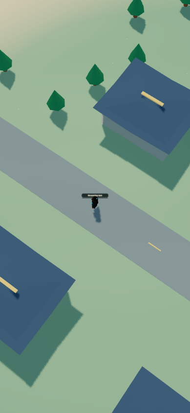

# World migration — stage 4

## Art direction

Both islands now use original painted, anime-inspired rendering: soft toon lighting, smoothly colored terrain, curved eave roofs with contrasting ridges, landmark ink edges, a gradient sky and sun, animated coastal foam and water strokes. Rounded shoreline geometry, rounded main-island foliage, illustrated cloud sprites, wind movement and soft ambient motes replace several visibly angular effects. All geometry and procedural art were authored in this repository; no external anime artwork was copied.

`frontend/src/game/worldArt.ts` owns the rendering treatment. It applies to procedural fallback geometry, imported campus assets, streamed island chunks, existing player models and interiors. The sky and outdoor motes hide indoors and restore on exit. Existing day, sunset, night and automatic lighting modes remain supported. Camera-relative sky, drifting clouds and player-following sunlight work in the shared coordinate system.

Terrain was lowered slightly to separate overlapping road surfaces. Street crossings have separated rendering heights; camera near clipping and shadow bias were adjusted to suppress depth flicker and shadow acne. The legacy rectangular lagoon and its banks are hidden because they crossed occupied city lots; their source objects remain in the code. Building footprints, interactive nodes and gameplay collision rules are preserved.

Blender sources and GLBs were regenerated using reusable `tools/blender/architecture.py` and `terrain_art.py`. Terrain uses smooth vertex colors rather than material wedges. Current GLB sizes:

| Chunk | Bytes |
| --- | ---: |
| Developer Metropolis campus | 184,684 |
| Developer Metropolis terrain | 203,596 |
| East Island far | 31,876 |
| East Island near | 169,948 |

## Graphics settings

Phone → Island map → Graphics quality offers Auto, Low, Balanced and High. The preference survives reload. Auto chooses a conservative profile for compact or limited hardware. Profiles cap resolution, shadows, cloud count, particle count and paint detail. Low disables dynamic shadows; higher profiles add landmark outlines and richer shading. Switching profiles updates the existing renderer without moving the player, resetting the camera or discarding streamed chunks.

| Profile | Pixel ratio cap | Shadows | Shadow map | Clouds | Motes |
| --- | ---: | --- | ---: | ---: | ---: |
| Low | 1 | Off | 512 | 5 | 24 |
| Balanced | 1.25 | On | 1024 | 9 | 48 |
| High | 1.75 | On | 2048 | 14 | 72 |

## Verification

- `npm run build` passed, including TypeScript checking. Vite retains the existing main-chunk size warning, approximately 503.90 kB uncompressed.
- `git diff --check` passed.
- Real renderer crossing/return/repeat passed at desktop and 390 × 844 mobile viewport sizes. Both observed far → near → far → near, predictive loading before arrival, exactly two chunk requests, maximum coordinate step 14 and no collider/sea-gap errors.
- Desktop balanced fixture samples ranged from 30 to 59 FPS across runs; the mobile low-profile sample was 53 FPS. Multiple browser tabs were active in the final desktop run. These are local isolated-fixture readings, not full-game benchmarks or measurements on a physical phone.
- Live Low/High switching preserved renderer ID, player position and stream request count; cloud/particle/shadow limits matched the profiles. Animation time continued advancing.
- Office entry hid the sky; exit restored outdoor rendering with the same renderer, player coordinates and loaded chunks. This checks the renderer transition, not every production navigation interaction.
- Day, sunset, night and dynamic modes were exercised without shader errors. Actual WebGL frame exports were inspected; visible shadow striping was corrected. Native browser screenshot capture was unavailable, so the development fixture exports the rendered canvas directly. The capture control and fixture remain development-only.
- The regular game loaded; phone graphics controls applied Low, retained Low after reload, and were restored to Auto. Fresh browser sessions reported no errors or warnings during these checks.
- `node tools/testing/streaming-network-smoke.mjs` passed against an isolated temporary database: two players, 72 replicated moves, final coordinates `(3280,784)` and `(3288,784)`, invalid off-bridge movement rejected, saved coordinates retained. No real account data was modified by that test.
- GLB vertex-color attributes and the main hall/east tower positions were inspected. Interactive coordinates remained unchanged.

## Evidence and reproduction

[Office rendering frame](images/stage4-office.png)

1. Run `npm run dev` and visit `/streaming-smoke.html` for the real-renderer crossing test, quality/lighting controls and frame export.
2. Run `node tools/testing/streaming-network-smoke.mjs` and `npm run build`.
3. Regenerate assets with Blender background Python using `tools/blender/build_developer_metropolis.py` and `build_east_island.py`.

## Scope and limits

This is a stylized rendering pass, not a photorealistic asset replacement. Existing movement, camera modes, activities, multiplayer and backend remain in place. No NPCs or abilities were added. No GDevelop files were deleted. Physical Android/iOS profiling, full multiplayer load testing and exhaustive account/integration regression testing remain outstanding; no zero-bug claim is made.

Stop after the local stage-four commit. Do not push or begin GDevelop deletion planning until the user says **proceed to step five**. Stage five still requires explicit approval before any deletion.
